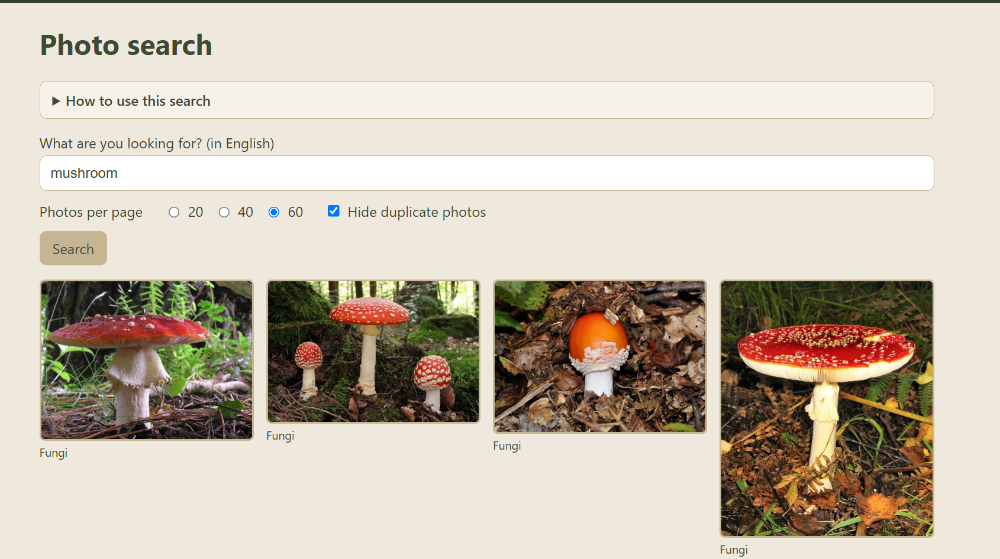

**Status:** a small learning project. It works, but it is a simplified rebuild of a project for an organisation

# Forest photo search

Search a photo collection by describing what is in the picture, for example *"owl"* or *"old oak"*.
It uses [OpenCLIP](https://github.com/mlfoundations/open_clip) embeddings, a small Python API and a React + TypeScript front end.



## Background

First version was built as a volunteer for a forest conservation fund, [Sengirės fondas](https://www.sengiresfondas.lt/).
Their photos were scattered accross multiple Drives and folders, which was a real inconvennience when finding a photo of something specific was essential for creating promotional (or other) content. Thus, I tried to help with a photo search tool.

The fund's version is a Streamlit app on their own photo bank. **This repository is a separate rebuild with an open-licensed demo collection**, so the code can be public. No photos from the fund are in this repo.

## Features

- Free-text search: describe the photo in English
- Best matches first, 20 / 40 / 60 per page with a "show more" button
- Duplicate detection: near-identical pictures are grouped and can be hidden; each result shows how many copies exist
- Click a photo to see its **full path in the collection** (with a copy button) and the paths of its copies, so you can find the original file
- All interface text lives in one file (`frontend/src/strings.ts`) to make translating easy

## How it works


1. `build_data.py` makes a small preview of each photo and computes one embedding vector per photo with a CLIP model.
2. When you search, the API turns your text into a vector with the same model and ranks photos by similarity.
3. Photos whose vectors are almost identical (cosine similarity ≥ 0.98) are treated as copies of one picture.
4. The React app shows the results and handles paging, loading and error states.

## Run it

You need Python 3.10+ and Node.js (current LTS).

```bash
# 1. Python side
cd backend
python -m venv .venv && source .venv/bin/activate # Windows: .venv\Scripts\activate
pip install -r requirements.txt

# 2. Get open-licensed demo photos from Wikimedia Commons (or put your own photos in ../demo_photos)
python fetch_demo_photos.py --contact you@example.com
#    look through demo_photos/, delete photos you don't want, then refresh the credits:
python fetch_demo_photos.py --contact you@example.com --credits-only

# 3. Build the data (first run downloads the model)
python build_data.py --photos ../demo_photos --out data

# 4. Start the API
uvicorn main:app --reload --port 8000

# 5. In a second terminal: the web app
cd frontend
npm install
npm run dev          # open http://localhost:5173
```

To serve everything from one process, run `npm run build` in `frontend/`; the API then also serves the built app at http://localhost:8000.

Tests (the model is replaced by a fake in tests, so they run fast and need no downloads):

```bash
cd backend && pip install -r requirements-test.txt && pytest
cd frontend && npm test
```

## Limitations

- Search works in **English** only. The model is not trained for Lithuanian.
- CLIP is good at concrete subjects (owl, mushroom, river) and weak at subjective categories ("old forest") and rare species.
- Duplicate detection uses similarity of embeddings with a fixed threshold, so an edited or cropped copy is usually caught but not always, and two different photos can occasionally be grouped.
- There is no login or rights management. It is a search tool, not a publishing workflow.
- The duplicate check compares all photos with each other in blocks, which is fine for thousands of photos but would need an approximate index for hundreds of thousands.

## Demo photos

Credits and licenses are in [demo_photos/ATTRIBUTION.md](demo_photos/ATTRIBUTION.md).

